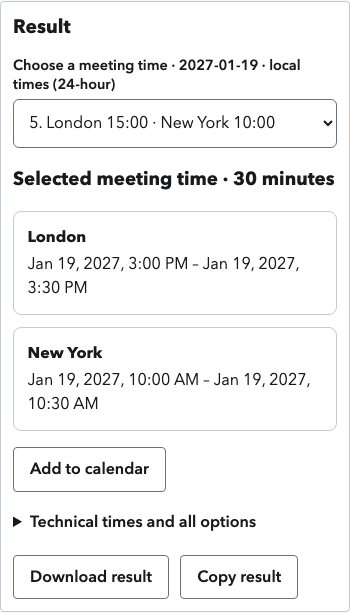

# Fresh-user and user-experience testing

## Scope and method

This was **agent-led task-based testing, not a human-participant study**. An independent evaluator used the rendered application without inspecting implementation/tests or submitting provider requests. Testing covered every utility at 1280×900 and 390×844, using fresh ordinary inputs, normal controls and actual downloaded files. There were no network mocks. Live AI acceptance was performed separately against real Worker versions and Jev.

The exploratory baseline recorded **33 unique cases: 26 passed, five failed observations, two deliberately limited**. Five observations are not five distinct defects: JSON stale guidance appeared at both sizes. There were also 14 keyboard/disclosure checks, 54 screenshots, 48 layout snapshots with no page-wide overflow, and 13 downloaded artifacts inspected. The evaluator recorded zero API calls and no console/page errors. These counts describe the initial evaluation, not a claim that every case was repeated after fixes.

[Case-level observations](./user-experience-cases.json) retain initial tasks, failures and manual recovery. Full local evidence is in `~/.hermes/cache/scratch/utilitypot-ux-round2/`, including `report.md`, `observedcases.json`, `case-counts.json`, browser events, keyboard checks, downloaded files and screenshots.

## Tasks exercised

- **CSV → nested JSON:** quoted company names, commas and escaped quotes, leading-zero order identifiers, grouping selection, parent/child inspection and JSON download at both sizes.
- **Dates:** year/month precision, ambiguous numeric dates, invalid days, a blank row, convention correction, wholly empty input, CSV downloads and mobile reading.
- **Meetings:** London/New York city entry, optional names left empty, choosing a different slot, comparing local times, selected-event downloads, unknown-city recovery and mobile controls.
- **JSON → CSV:** a single object, nested objects and arrays, multiple record arrays, explicit Stop/Keep/Omit policies, recovery and downloaded CSV values.
- **Diagrams:** a private branching graph created through normal node/edge controls, rendered SVG and Mermaid/SVG downloads without raw-plan import or provider calls.
- **Entities:** manual correction of a repeated name, selecting a different exact source occurrence, checking highlights/offsets and downloading the corrected JSON at both sizes.
- **Webpage Q&A:** pasted/URL mode controls, question entry, supported-host disclosure, informed provider submission and mobile input readability. This evaluator deliberately did not submit AI or claim to test answers/downloads.

Tab and Shift+Tab traversal, Enter on disclosures, the skip link and mobile menu/Escape were checked. This was not exhaustive keyboard-only completion, a screen-reader audit or a claim of accessibility conformance. Physical-device native pickers, clipboard transfer, actual calendar import and non-Chromium engines were not tested by this evaluation.

## Findings fixed and retested

### 1. CSV entered before initialization lost its input event

The evaluator's first mobile paste left the grouping selector empty; pasting the identical input again recovered. The evaluator could not reproduce it in subsequent trials. The parent then created a deterministic regression by delaying the actual JavaScript module, entering the same kind of CSV before listeners attached, and releasing the module. The grouping value stayed empty before the fix.

The module now reads non-empty source already present when initialization completes. The delayed-module regression passes and produces a valid result without repasting. No conversion/provider output was mocked.

### 2. JSON guidance described the previous document

After a one-row conversion, replacing the source with multiple arrays reset record selection but left “No nested arrays found” visible. Guidance now resets to “Choose records to inspect nested arrays before conversion.” Changing policy without a selection does not make claims about unseen records. Selecting the orders array identifies its `tags` path.

The regression failed on stale text before the fix and passes now. Rejection wording also names the visible **Keep as JSON text in a cell / Omit nested-array fields / Stop** choices rather than internal `join`/`reject` policy identifiers. Rejection and omission safeguards remain intact.

### 3. Mobile date words and values were fragmented

At 390×844, table headers/statuses such as “Normalized” and “partial” broke into multiple fragments. Mobile results now use semantic definition-list records with whole readable labels, values, statuses and notes. Desktop tables and CSV exports remain unchanged; missing display values use an em dash while original blank values remain unchanged in the export.

A text-range regression measured the original `partial` status across two lines; it now occupies one line. Result values remain present and there is no page-wide overflow. Actual after-fix pixels were inspected, not just geometry.

### 4. Meeting choices clipped the second city/time

The original fifth choice needed about 507 pixels of text space in a control with about 276 pixels available. Repeating the full date for each participant hid the second time. Choices now use compact 24-hour local times, place the availability date in the label, annotate differing local dates, and distinguish duplicate DST wall-time choices with a UTC prefix. Selected full-name/city cards remain immediately below.

The mobile text-width regression failed before the fix and passes now. Independent formatter checks covered previous-day/year rollover and DST distinction. Calendar execution and export data were not changed.

## Verification after fixes

- All four focused browser regressions passed after observed failures. They are retained in `tests/user-readiness.spec.mjs`.
- Full local gates: **68 unit/security, six release/contract and 77 browser tests**, actual Worker execution and extracted-release execution; check/build/format and zero dependency vulnerabilities.
- An independent source review found no blocking issue in the main UX changes and checked date/DST formatter behavior. The additional JSON error wording is a message-only change covered by the browser regression.
- Final runtime source: `5f6544a87620aef75ed0a61d32787c4d1d28a104`; non-production version `d01269c1-3dd1-45da-bdb2-fc7b96a5dc4b`.
- Final real-browser/real-Jev acceptance covered all seven tools: **18 scenarios, 17 automatic passes and one explicitly recorded CSV mapping correction; zero failed scenarios**. Source-backed Q&A, public reading, original/fresh/absent entities and mobile answer focus were verified in this separate live run.
- Instrumented browser diagnostics performed **32 successful entity actions**, including 24 with the original repeated-name paragraph and eight varied inputs. Exact browser payloads and provider boundaries were captured only for the fixed synthetic paragraph. These were real calls, not fixture successes.

See [final machine-readable evidence](./product-review-final-evidence.json) and [qualification history](./product-review-verification.md). The earlier single entity HTTP 503 remains unexplained: passing subsequent trials does not establish its cause or guarantee elimination. It remains an explicit reliability risk rather than being erased by the rerun.

The final live runs restored preview settings to disabled and verified production deployment metadata was unchanged. These tests do not constitute a production deployment, merge approval or a guarantee of model correctness on every possible input.
